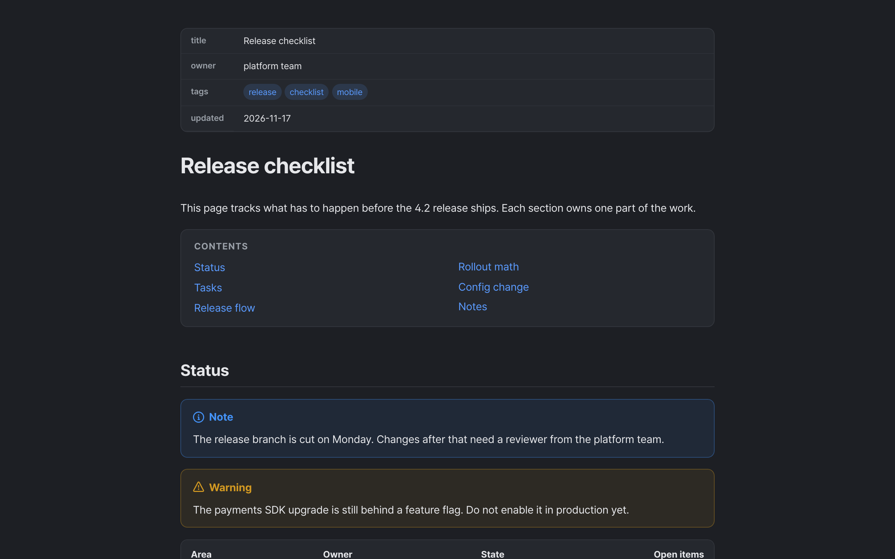
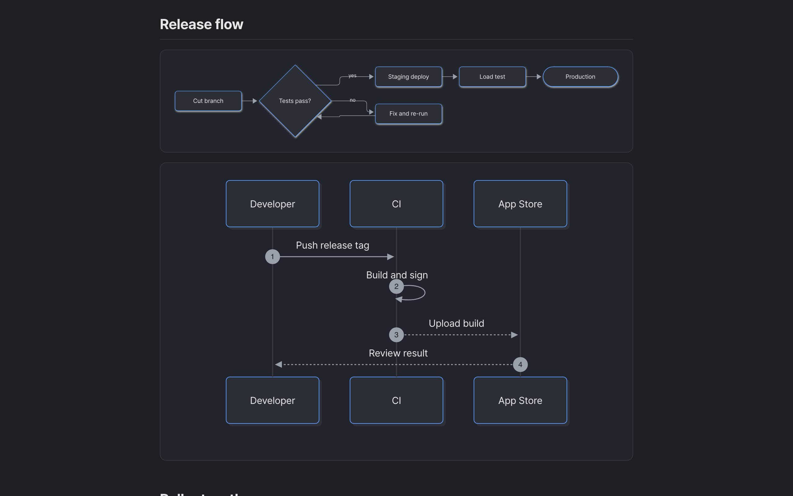
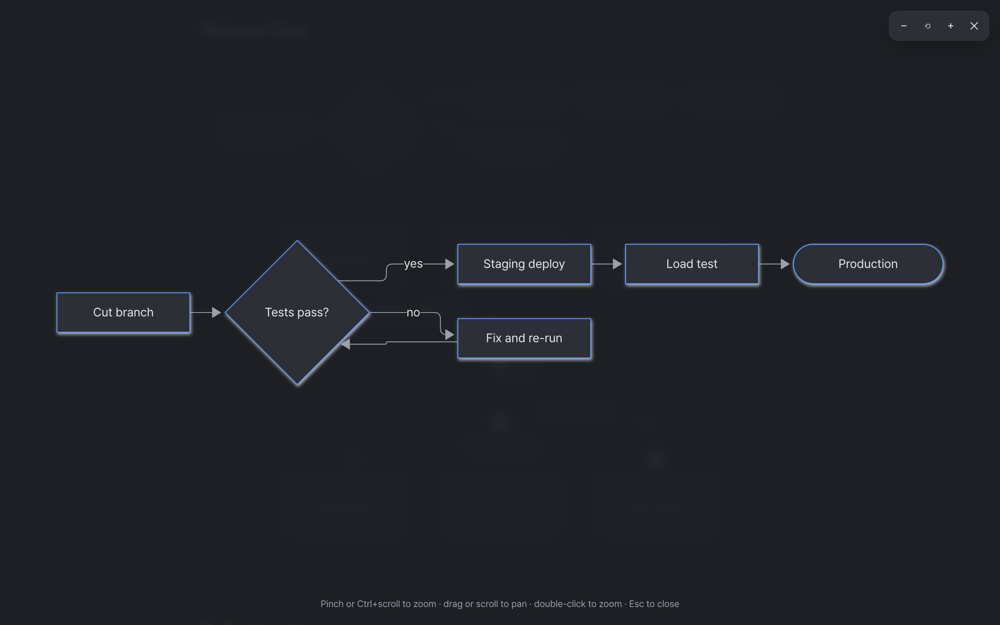
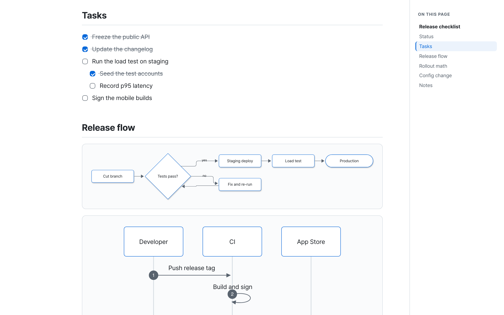

<p align="center"></p>

<h1 align="center">MDViewer</h1>

<p align="center">
  <a href="https://paseo.sh">Paseo</a>용 Markdown 뷰어 겸 편집기입니다.<br>
  대화 속 <code>.md</code> 링크를 누르면 탭에서 문서를 읽고, 다이어그램과 수식을 보고, 바로 고칠 수 있습니다.
</p>

<p align="center">
  
  
  
</p>

<p align="center"><a href="README.md">English</a> · 한국어</p>

<p align="center">
  
</p>

- **누른 자리에서 열립니다.** 답변 속 Markdown 링크, 파일 트리, 검색 결과가 이 뷰어로 열립니다. 턴이 끝나면 그 턴에 생성·변경된 Markdown 파일이 버튼으로 나옵니다.
- **문서처럼 읽힙니다.** GitHub 방식 Markdown에 알림 상자, 체크리스트, 각주, 머리말 정보, 목차, 코드 강조, KaTeX 수식을 지원하고 Paseo의 밝은 테마와 어두운 테마를 따릅니다.
- **다이어그램을 그립니다.** Mermaid 다이어그램을 Paseo 테마 색으로 그립니다. 누르면 전체 화면으로 열리고 핀치로 확대합니다.
- **그 자리에서 고칩니다.** 같은 탭에서 보기, 분할, 원문 모드를 오갑니다. 분할 모드는 위에 원문, 아래에 미리보기를 두고 입력하는 대로 다시 그리며, 수정 내용은 자동으로 저장합니다.
- **이름이 붙은 문서 탭.** 같은 대화에서 같은 파일을 다시 열면 기존 MDViewer 탭으로 이동합니다.

Paseo에는 Markdown 미리보기가 이미 있습니다. MDViewer는 문서를 하루 종일 읽고 고치는 사람을 위한 플러그인입니다. 실시간 미리보기가 붙은 분할 편집, 목차, 찾기, 전체 화면 다이어그램, 파일 경로 메뉴, 턴 중 변경된 문서를 모아 주는 버튼을 더합니다.

## 설치

```sh
paseo plugin install git:robinhur/paseo-mdviewer --ref v0.1.0
```

로컬에 받아서 설치할 수도 있습니다.

```sh
git clone https://github.com/robinhur/paseo-mdviewer.git
paseo plugin install "$(pwd)/paseo-mdviewer"
```

실행에 필요한 의존성이 없습니다. Markdown 엔진과 Mermaid, KaTeX, DOMPurify 런타임을 `server/generated/`에 미리 빌드해 두어서, 설치할 때 빌드하거나 내려받는 것이 없습니다.

데몬에서 플러그인을 켜 두어야 합니다(**Settings → Plugins → Enable plugins**). 앱과 데몬 모두 Paseo 0.15.4 이상이 필요합니다.

`.md` 파일을 처음 열면 Paseo가 어떤 뷰어로 열지 묻습니다. **MDViewer**를 고르고 **다시 묻지 않기**를 체크하세요. 나중에 **Settings → Files**나 탭 메뉴의 **Open with…**에서 바꿀 수 있습니다.

## 사용법

| 어디서 | 일어나는 일 |
|---|---|
| 답변 속 `.md` 링크 | Paseo 파일 탭으로 열리고 MDViewer가 그립니다 |
| 답변 아래 버튼 | 파일마다 MDViewer 탭으로 엽니다 |
| 파일 트리나 검색 | MDViewer를 뷰어로 골라 두면 MDViewer로 열립니다 |
| `/mdv 경로/파일.md[:줄]` | 그 줄에서 파일을 엽니다. 워크스페이스에 같은 이름이 하나뿐이면 파일 이름만 적어도 됩니다 |
| 문서 안의 다른 `.md` 링크 | 그 파일을 자기 탭으로 엽니다 |

### 탭 안에서

- **보기 / 분할 / 원문**으로 모드를 바꿉니다. 분할은 원문을 미리보기 위에 둡니다.
- **목차**는 제목 목록을 문서 옆에 띄우고 스크롤을 따라갑니다.
- **찾기**(⌘F)는 찾은 곳을 표시하고 Enter로 다음 위치로 넘어갑니다.
- **전체 폭**과 **A- / A+**로 본문 폭과 글자 크기를 바꿉니다. 트랙패드 핀치도 같은 동작을 합니다.
- **경로를 클릭**하거나 오른쪽 클릭하면 경로, 파일 이름, 폴더를 복사하거나 Finder에서 보거나 기본 앱으로 엽니다.
- **다이어그램이나 이미지를 클릭**하면 전체 화면으로 엽니다. 핀치나 Ctrl+스크롤은 포인터 위치에서 확대하고, 드래그나 스크롤은 이동, 더블클릭은 확대 전환, Esc는 닫기입니다.
- 체크리스트의 **체크박스를 클릭**하면 파일에 바로 반영합니다.
- **코드 블록에 마우스를 올리면** 복사 버튼이 나옵니다.

<p align="center">
  
  
</p>
<p align="center">
  
</p>

플로우차트, 시퀀스, 상태, 클래스, ER, 간트, 파이, 마인드맵, Git 그래프는 테스트로 확인합니다. 다른 Mermaid 다이어그램도 같은 렌더러로 그립니다.

### 에이전트 카드 도구

**에이전트 카드 도구**를 켜면 Claude와 Codex 세션에 `show_markdown` 도구가 붙습니다. 에이전트가 보고서나 계획서를 쓴 뒤 이 도구를 부르면, 대화에 문서 제목과 주요 절, 열기 버튼이 담긴 카드가 나옵니다.

## 설정

**Settings → Plugins → MDViewer**의 톱니바퀴, 또는 Command Center의 **MDViewer 설정**에서 엽니다. 값은 데몬에 저장되어 연결된 모든 기기가 같이 씁니다.

| 설정 | 기본값 | |
|---|---|---|
| 턴 뒤에 변경된 문서 표시 | 켬 | 이번 턴에 생성·변경된 Markdown 파일을 답변 아래에 보여 줍니다 |
| 에이전트 카드 도구 | 끔 | 에이전트에 `show_markdown`을 붙입니다. 바꾼 뒤 새로 여는 세션부터 적용됩니다 |
| 문서를 여는 모드 | 보기 | 새 탭의 시작 모드 |
| 본문 폭 | 보통 | 좁게, 보통, 전체 폭 |
| 글자 크기 | 100% | 새 탭의 시작 크기 |
| 자동 저장 | 켬 | 끄면 저장 버튼을 누를 때까지 저장하지 않습니다 |

## 언어

화면 글자는 영어와 한국어를 지원하고 Paseo 앱 언어를 따릅니다. 그 밖의 언어에서는 영어로 보입니다.

## 보안

Markdown 파일에는 HTML이 들어갈 수 있으므로, MDViewer는 모든 문서를 신뢰하지 않는 내용으로 다룹니다.

- 미리보기는 출처가 분리된 샌드박스 iframe에서 돕니다. Paseo 앱과 그 저장소, 데몬에 접근할 수 없습니다.
- 렌더링한 HTML은 [DOMPurify](https://github.com/cure53/DOMPurify)를 거칩니다. 스크립트, 이벤트 핸들러, `javascript:` 링크, 폼, 프레임, 스타일 시트를 제거합니다.
- 콘텐츠 보안 정책(CSP)이 뷰어 자체 스크립트만 허용하고, `https` 이미지 불러오기를 뺀 모든 네트워크 요청을 막습니다.
- 프레임이 패널에 요청할 수 있는 것은 다섯 가지입니다. 링크된 파일 열기, 웹 링크를 브라우저로 열기, 코드 블록 복사, 체크박스 반영, 글자 크기 변경입니다.
- 데몬은 Markdown 파일만 읽고 씁니다. 파일을 새로 만들지 않고, "기본 앱으로 열기"는 Markdown 파일에만 동작합니다.

테스트는 스크립트 태그, 이벤트 핸들러, `javascript:` 링크가 든 문서를 실제 미리보기에 띄워서 하나도 실행되지 않는지 확인합니다.

## 동작 방식

데몬이 markdown-it, highlight.js, KaTeX로 Markdown을 HTML로 바꿉니다. 앱은 그 HTML을 샌드박스 iframe에 보여 주고, 그 안에서 Mermaid가 다이어그램을 그립니다. 웹 뷰가 없는 클라이언트에서는 Paseo 기본 Markdown 렌더러로 문서를 보여 줍니다.

데몬은 턴 시작과 종료 때 에이전트 작업 폴더 아래 Markdown 파일의 메타데이터를 비교합니다. 생성·변경된 파일을 최근 변경 순서로 최대 12개까지 버튼으로 붙입니다. 바뀌지 않은 파일은 답변에서 언급해도 버튼으로 추가하지 않으며, 본문 파일 링크와 `/mdv`로 계속 열 수 있습니다. 어떤 프로그램이 고쳤는지가 아니라 그 턴 동안 변경됐는지를 확인합니다.

설계는 [docs/ko/ARCHITECTURE.md](docs/ko/ARCHITECTURE.md), 설정은 [docs/ko/SETTINGS.md](docs/ko/SETTINGS.md)에 있습니다.

## Better Paseo와 같이 쓸 때

Better Paseo의 **Plugin markdown for replies**는 답변을 직접 그리고 파일 링크를 운영체제로 엽니다. 답변 속 Markdown 링크를 MDViewer로 열려면 이 설정을 끄세요. 답변 아래 버튼은 어느 쪽이든 동작합니다.

## 데이터 접근

- 데몬이 도는 기기에서 Markdown 파일과 그 파일이 참조하는 이미지를 읽고, 편집한 Markdown 파일을 씁니다.
- 에이전트 작업 폴더 아래 파일 경로와 메타데이터를 스캔해 턴 중 생성·변경된 Markdown 파일을 찾습니다. 이 스캔은 파일 본문이나 대화 글을 읽지 않습니다.
- Finder에서 보기, 기본 앱으로 열기, 폴더 열기를 고르면 데몬이 도는 기기에서 `open`(macOS), `explorer`(Windows), `xdg-open`(Linux)을 실행합니다.
- 자기 탭으로 연 파일 목록을 `~/.paseo/plugin-data/paseo-mdviewer/recent.json`에 둡니다.
- 플러그인이 직접 보내는 네트워크 요청은 없습니다. 문서에 원격 이미지가 있으면 문서를 열 때 `https`로 불러오고, 그 서버는 이미지 요청이 있었다는 것을 알게 됩니다.

## 알려진 한계

- macOS 데스크톱 앱에서 시험했습니다. Windows와 Linux의 파일 관리자 명령, 모바일 앱은 시험하지 않았습니다.
- 답변 링크로 연 탭은 Paseo 파일 탭이고, 그 아이콘은 Paseo가 파일 종류에 따라 정합니다.
- 답변 버튼으로 연 탭은 그 대화에 속합니다. 그래서 같은 파일이 탭 여러 개로 열릴 수 있습니다.
- 변경 문서 버튼에는 시작 스냅샷이 필요합니다. 플러그인을 불러올 때 이미 진행 중인 턴에는 버튼을 붙이지 않습니다. 스캔 범위 밖의 파일이나 시작 스캔이 도달하기 전의 빠른 변경을 놓칠 수 있고, 같은 폴더에서 다른 에이전트나 프로그램이 변경한 파일도 포함될 수 있습니다.
- 원문 편집기는 일반 텍스트입니다. 줄 번호와 문법 색이 없습니다.
- `http`로 제공되는 이미지는 보이지 않습니다. 로컬 이미지는 장당 8MB까지 넣습니다.
- 전체 화면 다이어그램, 찾기, 목차는 데스크톱이나 웹 앱에서만 됩니다.

## 개발

```sh
npm install
npm run build         # engine/을 server/generated로 묶고, 런타임을 넣고, 라이선스 고지를 씁니다
npm run typecheck
npm test              # 렌더러, 경로 찾기, 파일 접근, 번역
npm run test:browser  # Chromium에서 소독, 보안 정책, 다이어그램 확인 (CHROME_PATH 필요)
npm run screenshots   # docs/sample.md를 assets/에 그립니다 (CHROME_PATH 필요)
paseo plugin reload paseo-mdviewer
paseo plugin logs paseo-mdviewer
```

`engine/`을 고치거나 mermaid, katex, dompurify, markdown-it 플러그인을 올린 뒤에는 `npm run build`를 돌리고, 다시 만들어진 `server/generated/`와 `THIRD_PARTY_NOTICES.md`를 커밋합니다. 둘이 원본과 다르면 CI가 실패합니다.

| 경로 | 내용 |
|---|---|
| `engine/` | Markdown 렌더러. 빌드할 때 묶습니다 |
| `server/` | RPC 처리, 파일 접근, 답변 버튼, 에이전트 도구 |
| `client/` | 패널, 툴바, 설정 화면, 대화 행, 번역 |
| `client/shell.ts` | 미리보기 문서: 스타일, 소독, Mermaid, 목차, 찾기, 확대 |
| `shared/` | RPC 계약, 설정 스키마, 경로 찾기 |
| `scripts/` | 빌드, 런타임 내장, 스크린샷 |
| `test/` | 단위 테스트와 브라우저 테스트 |
| `docs/` | 설계, 설정, 스크린샷용 예시 문서 |

## 라이선스

MIT. 함께 묶은 외부 패키지와 각 라이선스는 [THIRD_PARTY_NOTICES.md](THIRD_PARTY_NOTICES.md)에 있습니다.
