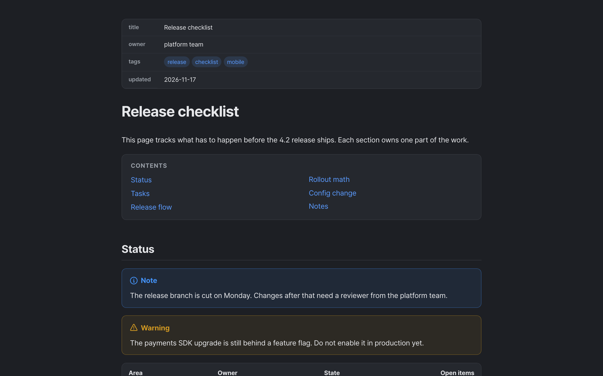
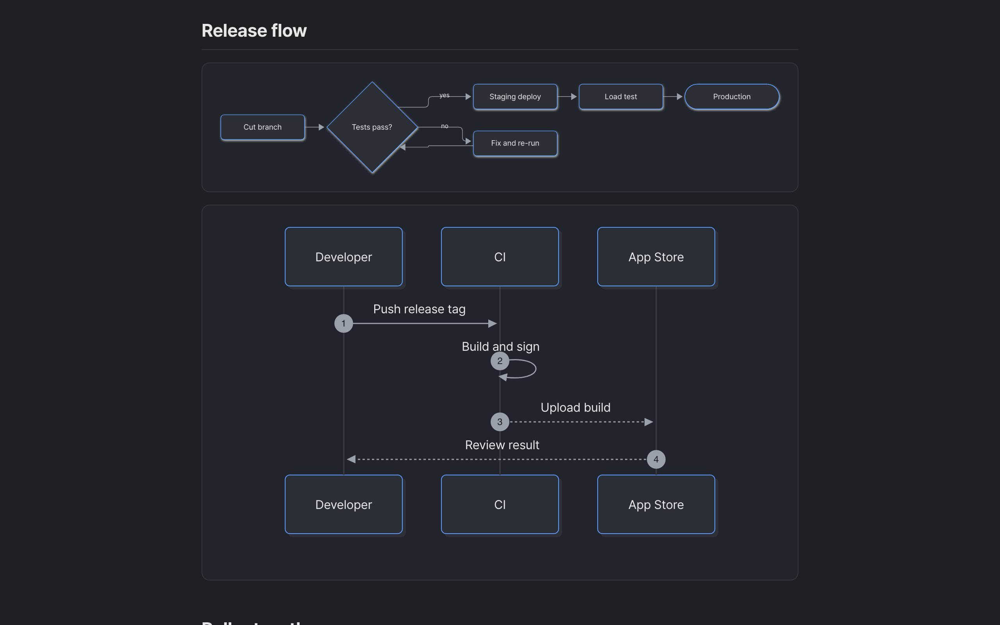
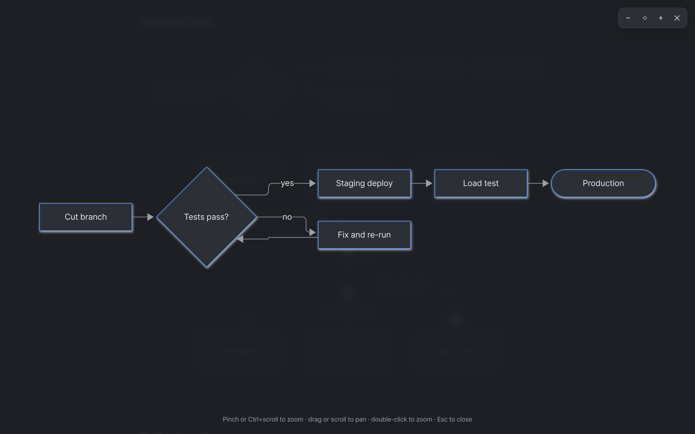
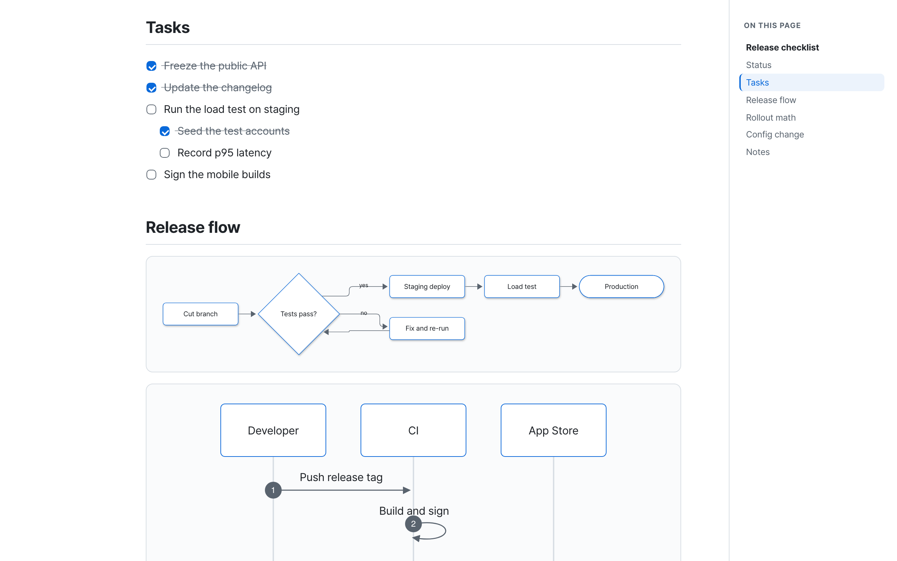

<p align="center"></p>

<h1 align="center">MDViewer</h1>

<p align="center">
  A Markdown reader and editor for <a href="https://paseo.sh">Paseo</a>.<br>
  Click a <code>.md</code> link in a conversation and read it in a tab, with diagrams, math and live editing.
</p>

<p align="center">
  
  
  
</p>

<p align="center">English · <a href="README.ko.md">한국어</a></p>

<p align="center">
  
</p>

- **Opens where you click.** Markdown links in replies, the Files tree and search open in the viewer. After a turn, buttons list Markdown files created or changed during that turn.
- **Reads like a document.** GitHub-flavored Markdown with alerts, task lists, footnotes, front matter, a table of contents, syntax highlighting and KaTeX math, in Paseo's light or dark theme.
- **Draws diagrams.** Mermaid diagrams in the colors of the Paseo theme. Click one to open it full screen and pinch to zoom.
- **Edits in place.** View, Split and Source modes in the same tab. Split shows the source above the preview and redraws as you type; edits save on their own.
- **Named document tabs.** Reopening a file from the same conversation switches to its existing MDViewer tab.

Paseo already previews Markdown files. MDViewer is for reading and editing documents all day: split editing with a live preview, an outline, find, full-screen diagrams, a file path menu, and buttons for documents changed during a turn.

## Install

```sh
paseo plugin install git:robinhur/paseo-mdviewer --ref v0.1.0
```

Or from a local checkout:

```sh
git clone https://github.com/robinhur/paseo-mdviewer.git
paseo plugin install "$(pwd)/paseo-mdviewer"
```

The plugin has no runtime dependencies. The Markdown engine and the Mermaid, KaTeX and DOMPurify runtimes are prebuilt in `server/generated/`, so installing runs no build step and fetches no additional packages.

Plugins must be enabled on the daemon (**Settings → Plugins → Enable plugins**). Requires Paseo 0.15.4 or later on the app and the daemon.

The first time you open a `.md` file, Paseo asks which viewer to use. Pick **MDViewer** and tick **Don't ask again**. You can change it later in **Settings → Files** or with **Open with…** in the tab menu.

## Use it

| Where | What happens |
|---|---|
| A `.md` link in a reply | Opens the file in a Paseo file tab, drawn by MDViewer |
| The buttons below a reply | Opens each file in its own MDViewer tab |
| The Files tree or search | Opens in MDViewer once it is the chosen viewer |
| `/mdv path/to/file.md[:line]` | Opens the file at that line. A bare file name works when only one file in the workspace has it |
| A link to another `.md` file inside a document | Opens that file in its own tab |

### In the tab

- **View / Split / Source** switch the mode. Split puts the source above the preview.
- **Outline** shows the headings beside the document and follows your scroll.
- **Find** (⌘F) highlights matches and steps through them with Enter.
- **Full width** and **A- / A+** change the reading width and text size. Pinch on a trackpad does the same.
- **Click the path** (or right-click it) to copy the path, file name or folder, reveal the file in Finder, or open it in the default app.
- **Click a diagram or image** to open it full screen. Pinch or Ctrl+scroll zooms at the pointer, drag or scroll pans, double-click toggles zoom, Esc closes.
- **Click a checkbox** in a task list to tick it in the file.
- **Hover a code block** for a Copy button.

<p align="center">
  
  
</p>
<p align="center">
  
</p>

Flowchart, sequence, state, class, ER, Gantt, pie, mindmap and git graph diagrams are covered by the test suite. Other Mermaid diagram types use the same renderer.

### Agent card tool

With **Agent card tool** turned on, Claude and Codex sessions get a `show_markdown` tool. An agent calls it after writing a report or plan, and the conversation shows a card with the document title, its main sections and an Open button.

## Settings

**Settings → Plugins → MDViewer** (cog), or **MDViewer settings** in the Command Center. Values are stored on the daemon and shared by every connected device.

| Setting | Default | |
|---|---|---|
| Show changed documents after each turn | On | Lists Markdown files created or changed during the turn below the reply |
| Agent card tool | Off | Gives agents `show_markdown`; applies to sessions opened afterwards |
| Open documents in | View | Starting mode for new tabs |
| Reading width | Normal | Narrow, normal or full width |
| Text size | 100% | Starting size for new tabs |
| Save automatically | On | Off: edits wait for the Save button |

## Languages

The interface is in English and Korean and follows the Paseo app language. Other languages show English.

## Security

A Markdown file can contain HTML, so MDViewer treats every document as untrusted.

- The preview runs in a sandboxed iframe with its own origin. It cannot reach the Paseo app, its storage or the daemon.
- Rendered HTML passes through [DOMPurify](https://github.com/cure53/DOMPurify), which removes scripts, event handlers, `javascript:` links, forms, frames and style sheets.
- A content security policy allows only the viewer's own scripts and blocks every network request except loading `https` images.
- The frame can ask the panel for five things: open a linked file, open a web link in the browser, copy a code block, tick a task, and change the text size.
- The daemon reads and writes Markdown files only. It never creates a file, and "Open in default app" works for Markdown files only.

The test suite loads a document with script tags, event handlers and `javascript:` links into the real preview and checks that none of them run.

## How it works

The daemon turns Markdown into HTML with markdown-it, highlight.js and KaTeX. The app shows that HTML in the sandboxed iframe, where Mermaid draws the diagrams. On clients without a web view, the tab shows the document with Paseo's own Markdown renderer.

The daemon compares Markdown file metadata under the agent's working directory at the start and end of a turn. It adds buttons for up to 12 newly created or changed files, newest first. Mentioning an unchanged file does not add a button; ordinary file links and `/mdv` still open existing documents. The comparison detects changes during the turn, not which program made them.

See [docs/ARCHITECTURE.md](docs/ARCHITECTURE.md) for the design and [docs/SETTINGS.md](docs/SETTINGS.md) for settings.

## With Better Paseo

Better Paseo's **Plugin markdown for replies** draws replies itself and opens file links with the operating system. Turn it off to have Markdown links in replies open in MDViewer. The reply buttons work either way.

## Data access

- Reads Markdown files and the images they reference on the daemon machine, and writes the Markdown files you edit.
- Scans file paths and metadata under the agent's working directory to find Markdown files created or changed during a turn. This scan does not read file contents or conversation text.
- Runs `open` (macOS), `explorer` (Windows) or `xdg-open` (Linux) on the daemon machine when you choose Reveal in Finder, Open in default app or Open containing folder.
- Keeps the list of files opened in their own tabs in `~/.paseo/plugin-data/paseo-mdviewer/recent.json`.
- Makes no network requests of its own. A document that embeds remote images loads them over `https` when you open it, which tells that server the image was requested.

## Known limits

- Tested on the macOS desktop app. The Windows and Linux file manager commands and the mobile apps are untested.
- Tabs opened from reply links use Paseo's file tab, whose icon Paseo chooses by file type.
- A tab opened from a reply button belongs to that conversation, so the same file can be open in more than one tab.
- Changed-document buttons require a start snapshot. A turn already running when the plugin loads gets no buttons. Bounded scans can miss files, and very early changes may happen before the start scan reaches them. Changes by another agent or program in the same directory can also appear.
- The source editor is plain text, without line numbers or syntax colors.
- Images served over plain `http` are not shown. Local images are embedded up to 8 MB each.
- Full-screen diagrams, find and the outline need the desktop or web app.

## Development

```sh
npm install
npm run build         # bundles engine/ into server/generated, embeds the runtimes, writes notices
npm run typecheck
npm test              # renderer, path matching, file access, translations
npm run test:browser  # sanitizing, the security policy and diagrams in Chromium (set CHROME_PATH)
npm run screenshots   # renders docs/sample.md into assets/ (set CHROME_PATH)
paseo plugin reload paseo-mdviewer
paseo plugin logs paseo-mdviewer
```

Run `npm run build` after changing `engine/` or upgrading mermaid, katex, dompurify or the markdown-it plugins, and commit the regenerated `server/generated/` and `THIRD_PARTY_NOTICES.md`. CI fails when they are out of date.

| Path | Contents |
|---|---|
| `engine/` | Markdown renderer, bundled at build time |
| `server/` | RPC handlers, file access, reply buttons, agent tool |
| `client/` | Panels, toolbar, settings screen, conversation rows, translations |
| `client/shell.ts` | The preview document: styles, sanitizing, Mermaid, outline, find, zoom |
| `shared/` | RPC contracts, settings schema, path matching |
| `scripts/` | Build, runtime embedding, screenshots |
| `test/` | Unit tests and browser tests |
| `docs/` | Architecture, settings, the sample document used for screenshots |

## License

MIT. Bundled third-party packages are listed with their licenses in [THIRD_PARTY_NOTICES.md](THIRD_PARTY_NOTICES.md).
