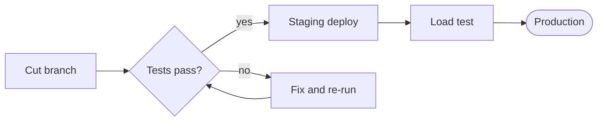
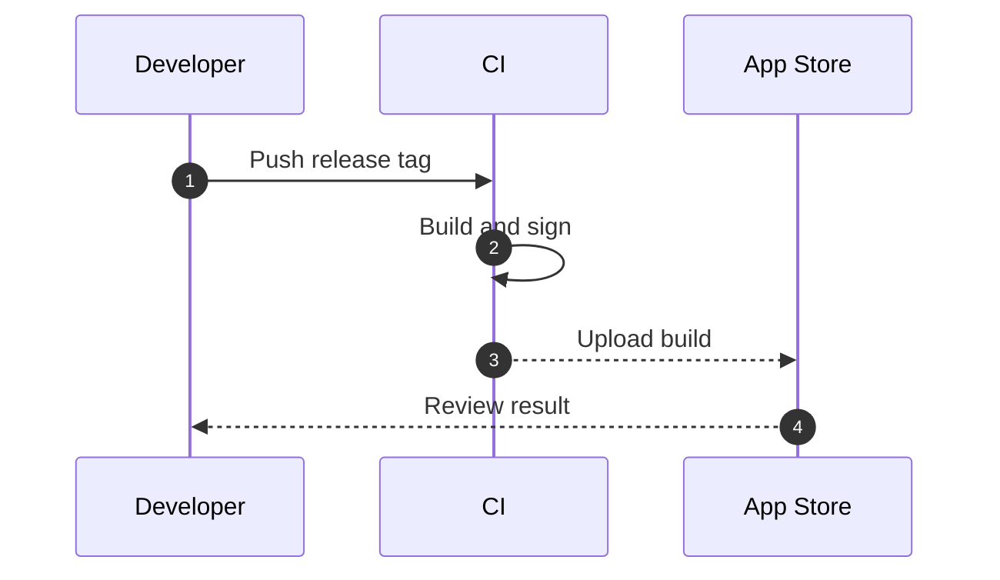

# Release checklist

This page tracks what has to happen before the 4.2 release ships. Each section owns one part of the work.

[[_TOC_]]

## Status

> [!NOTE]
> The release branch is cut on Monday. Changes after that need a reviewer from the platform team.

> [!WARNING]
> The payments SDK upgrade is still behind a feature flag. Do not enable it in production yet.

| Area | Owner | State | Open items |
|:---|:---|:---:|---:|
| API | Mina | Ready | 0 |
| Web app | Jordan | In review | 3 |
| Mobile | Sam | Blocked | 5 |
| Docs | Lee | Ready | 1 |

## Tasks

- [x] Freeze the public API
- [x] Update the changelog
- [ ] Run the load test on staging
  - [x] Seed the test accounts
  - [ ] Record p95 latency
- [ ] Sign the mobile builds

## Release flow





## Rollout math

The error budget for the month is $B = (1 - 0.999) \times 43{,}200 \approx 43.2$ minutes.

$$
\text{rollout}(t) = \min\left(100\%,\ 5\% \cdot 2^{\lfloor t / 6\text{h} \rfloor}\right)
$$

## Config change

```ts
export const releaseConfig = {
  version: "4.2.0",
  rollout: { start: 0.05, doubleEvery: "6h" },
  flags: { paymentsSdkV3: false },
};
```

```diff
- minimumOsVersion: "15.0"
+ minimumOsVersion: "16.0"
```

## Notes

Store review usually takes one to two days.[^review] Keep the <kbd>⌘</kbd> + <kbd>K</kbd> shortcut list in the help center up to date.

[^review]: Based on the last six releases.
